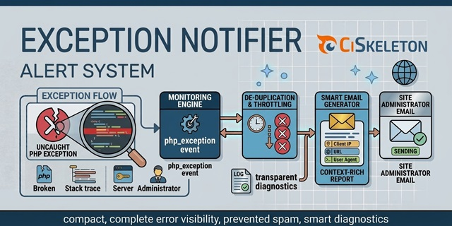

# CiSkeleton Plugin — Exception Notifier

Automatically emails administrators detailed reports when uncaught PHP exceptions occur. Includes de-duplication and throttling to prevent alert spam.

  

## Info

Listens for uncaught PHP exceptions and automatically emails detailed reports to the site administrator. This plugin helps maintain visibility into runtime issues that might otherwise go unnoticed in production.

## Features

* Hooks into the `php_exception` event for global exception coverage.
* Prevents email flooding with built-in de-duplication and hourly throttling.
* Generates smart, context-rich email messages with request data.
* Logs duplicate and throttled events for transparent diagnostics.

## Notes

Intended for production environments to ensure timely error awareness without overwhelming the administrator’s inbox. For development setups, CiSkeleton native error display remains preferable.

## License

MIT License. See [LICENSE](LICENSE.md) for details.

---

  <a href="https://github.com/ciskeleton">CiSkeleton</a> is created, developed, and maintained by <a href="https://github.com/bkader">Kader Bouyakoub</a>, trading as <a href="https://github.com/ianhubnet">Ianhub</a>.

